# ambientCG: Roofing Tiles materials

**27 assets from [ambientCG](https://ambientcg.com), dedicated to the public domain under [CC0](https://docs.ambientcg.com/license/).** Use them in any game, free or paid, and change them however you like; no credit is needed.

PBR materials as 1K and 2K JPG maps (colour, normal GL and DX, roughness, AO, displacement), one folder per resolution. 783.6 MB in all.

This is a copy kept by [zuujis-cc0](https://github.com/zuujis-cc0) so game makers can take single files from GitHub. It is not made by or affiliated with ambientCG: the originals, often in more formats and higher resolutions, are on [ambientcg.com](https://ambientcg.com). If they help you, consider [supporting ambientCG](https://www.patreon.com/ambientCG).

Every file is listed in [MANIFEST.tsv](MANIFEST.tsv) with its size and SHA-256. More free assets: [the Zuujis collection](https://github.com/zuujis-cc0/free-game-assets#readme).

| | | | |
| :-: | :-: | :-: | :-: |
| <a href="RoofingTiles001">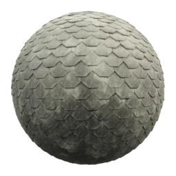</a> <b><a href="RoofingTiles001">Roofing Tiles 001</a></b> by ambientCG · <a href="https://ambientcg.com/a/RoofingTiles001">source</a> | <a href="RoofingTiles002">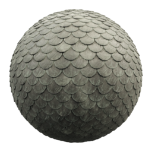</a> <b><a href="RoofingTiles002">Roofing Tiles 002</a></b> by ambientCG · <a href="https://ambientcg.com/a/RoofingTiles002">source</a> | <a href="RoofingTiles003">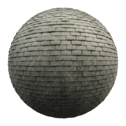</a> <b><a href="RoofingTiles003">Roofing Tiles 003</a></b> by ambientCG · <a href="https://ambientcg.com/a/RoofingTiles003">source</a> | <a href="RoofingTiles004">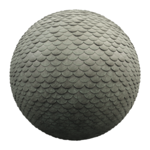</a> <b><a href="RoofingTiles004">Roofing Tiles 004</a></b> by ambientCG · <a href="https://ambientcg.com/a/RoofingTiles004">source</a> |
| <a href="RoofingTiles005">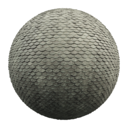</a> <b><a href="RoofingTiles005">Roofing Tiles 005</a></b> by ambientCG · <a href="https://ambientcg.com/a/RoofingTiles005">source</a> | <a href="RoofingTiles006">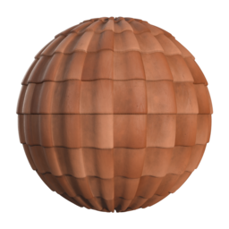</a> <b><a href="RoofingTiles006">Roofing Tiles 006</a></b> by ambientCG · <a href="https://ambientcg.com/a/RoofingTiles006">source</a> | <a href="RoofingTiles007">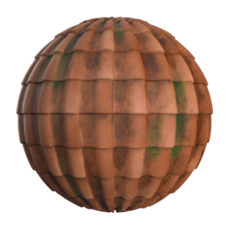</a> <b><a href="RoofingTiles007">Roofing Tiles 007</a></b> by ambientCG · <a href="https://ambientcg.com/a/RoofingTiles007">source</a> | <a href="RoofingTiles008">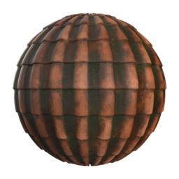</a> <b><a href="RoofingTiles008">Roofing Tiles 008</a></b> by ambientCG · <a href="https://ambientcg.com/a/RoofingTiles008">source</a> |
| <a href="RoofingTiles009">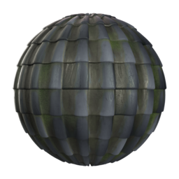</a> <b><a href="RoofingTiles009">Roofing Tiles 009</a></b> by ambientCG · <a href="https://ambientcg.com/a/RoofingTiles009">source</a> | <a href="RoofingTiles010">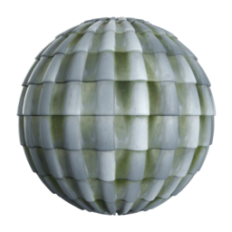</a> <b><a href="RoofingTiles010">Roofing Tiles 010</a></b> by ambientCG · <a href="https://ambientcg.com/a/RoofingTiles010">source</a> | <a href="RoofingTiles011A">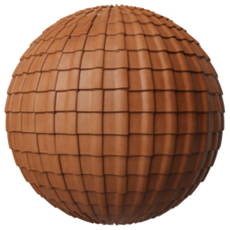</a> <b><a href="RoofingTiles011A">Roofing Tiles 011 A</a></b> by ambientCG · <a href="https://ambientcg.com/a/RoofingTiles011A">source</a> | <a href="RoofingTiles011B">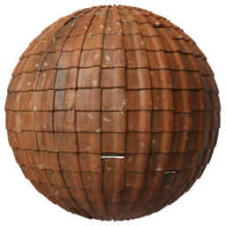</a> <b><a href="RoofingTiles011B">Roofing Tiles 011 B</a></b> by ambientCG · <a href="https://ambientcg.com/a/RoofingTiles011B">source</a> |
| <a href="RoofingTiles011C">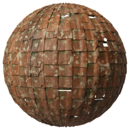</a> <b><a href="RoofingTiles011C">Roofing Tiles 011 C</a></b> by ambientCG · <a href="https://ambientcg.com/a/RoofingTiles011C">source</a> | <a href="RoofingTiles012A">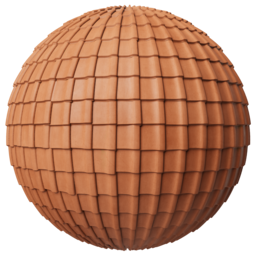</a> <b><a href="RoofingTiles012A">Roofing Tiles 012 A</a></b> by ambientCG · <a href="https://ambientcg.com/a/RoofingTiles012A">source</a> | <a href="RoofingTiles012B">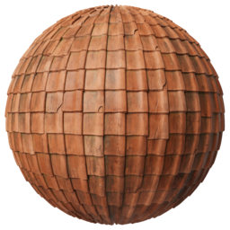</a> <b><a href="RoofingTiles012B">Roofing Tiles 012 B</a></b> by ambientCG · <a href="https://ambientcg.com/a/RoofingTiles012B">source</a> | <a href="RoofingTiles012C">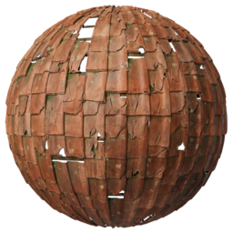</a> <b><a href="RoofingTiles012C">Roofing Tiles 012 C</a></b> by ambientCG · <a href="https://ambientcg.com/a/RoofingTiles012C">source</a> |
| <a href="RoofingTiles013A">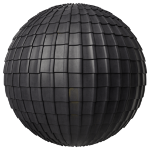</a> <b><a href="RoofingTiles013A">Roofing Tiles 013 A</a></b> by ambientCG · <a href="https://ambientcg.com/a/RoofingTiles013A">source</a> | <a href="RoofingTiles013B">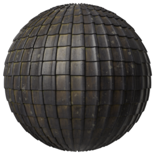</a> <b><a href="RoofingTiles013B">Roofing Tiles 013 B</a></b> by ambientCG · <a href="https://ambientcg.com/a/RoofingTiles013B">source</a> | <a href="RoofingTiles013C">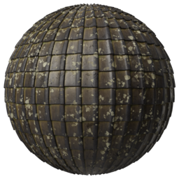</a> <b><a href="RoofingTiles013C">Roofing Tiles 013 C</a></b> by ambientCG · <a href="https://ambientcg.com/a/RoofingTiles013C">source</a> | <a href="RoofingTiles013D">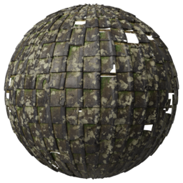</a> <b><a href="RoofingTiles013D">Roofing Tiles 013 D</a></b> by ambientCG · <a href="https://ambientcg.com/a/RoofingTiles013D">source</a> |
| <a href="RoofingTiles014A">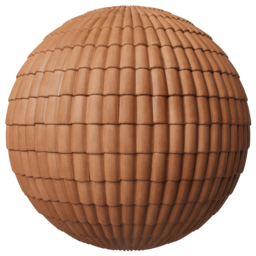</a> <b><a href="RoofingTiles014A">Roofing Tiles 014 A</a></b> by ambientCG · <a href="https://ambientcg.com/a/RoofingTiles014A">source</a> | <a href="RoofingTiles014B">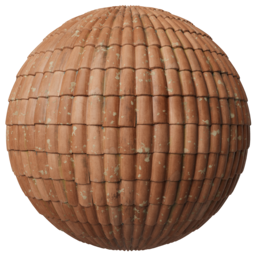</a> <b><a href="RoofingTiles014B">Roofing Tiles 014 B</a></b> by ambientCG · <a href="https://ambientcg.com/a/RoofingTiles014B">source</a> | <a href="RoofingTiles014C">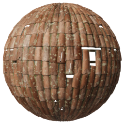</a> <b><a href="RoofingTiles014C">Roofing Tiles 014 C</a></b> by ambientCG · <a href="https://ambientcg.com/a/RoofingTiles014C">source</a> | <a href="RoofingTiles014D">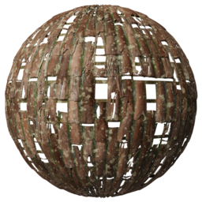</a> <b><a href="RoofingTiles014D">Roofing Tiles 014 D</a></b> by ambientCG · <a href="https://ambientcg.com/a/RoofingTiles014D">source</a> |
| <a href="RoofingTiles015A">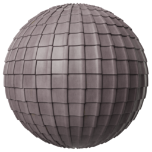</a> <b><a href="RoofingTiles015A">Roofing Tiles 015 A</a></b> by ambientCG · <a href="https://ambientcg.com/a/RoofingTiles015A">source</a> | <a href="RoofingTiles015B">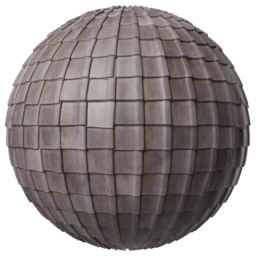</a> <b><a href="RoofingTiles015B">Roofing Tiles 015 B</a></b> by ambientCG · <a href="https://ambientcg.com/a/RoofingTiles015B">source</a> | <a href="RoofingTiles015C">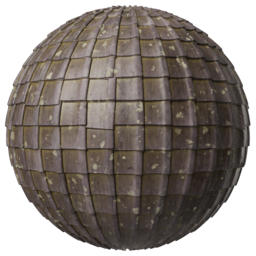</a> <b><a href="RoofingTiles015C">Roofing Tiles 015 C</a></b> by ambientCG · <a href="https://ambientcg.com/a/RoofingTiles015C">source</a> |  |

---

Kept up to date by this repository's own [update workflow](.github/workflows/update.yml), with code and plan from [cc0-mirror](https://github.com/zuujis-cc0/cc0-mirror). Something wrong? [Open an issue there](https://github.com/zuujis-cc0/cc0-mirror/issues/new) or use the [private report form](https://games.zuujis.com/report).
